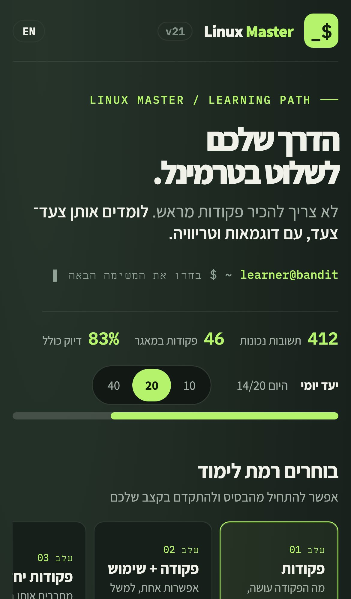
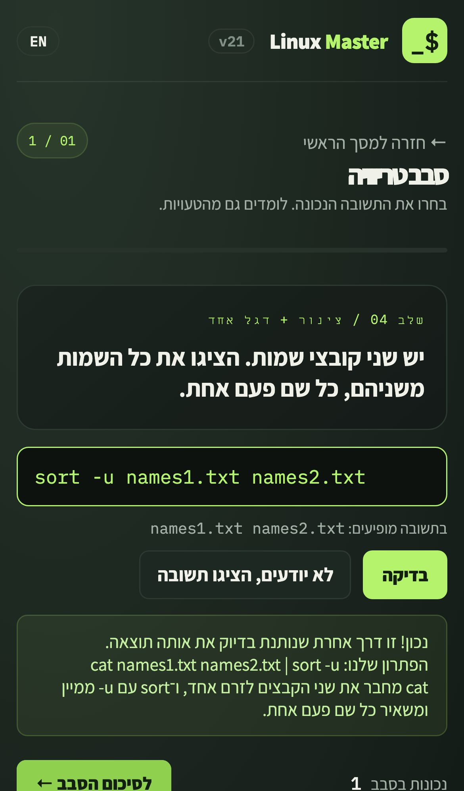
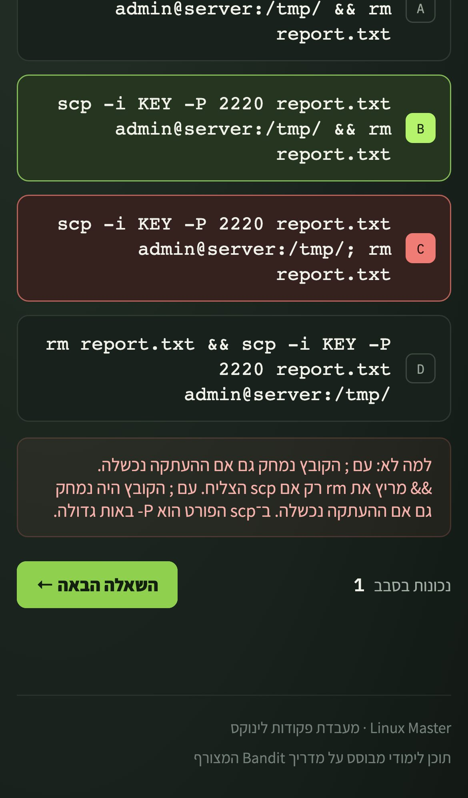
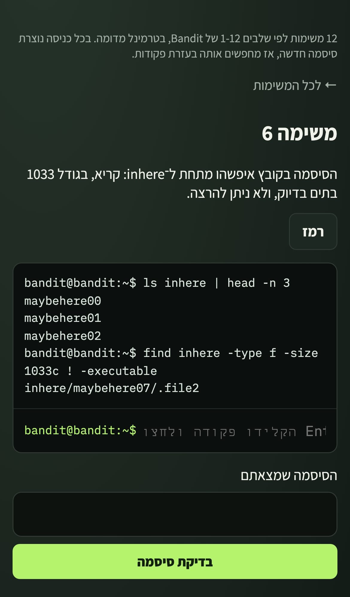

<div dir="rtl">

# Linux Master

מאמן לפקודות לינוקס שרץ כולו בדפדפן, בעברית ובאנגלית. האתר מתרגל פקודות עם חזרה מרווחת, בודק תשובות מוקלדות על ידי הרצתן בטרמינל מדומה, ומסתיים ב־12 משימות טרמינל בסגנון השלבים הראשונים של Bandit. זו אפליקציית רשת שאפשר להתקין ועובדת גם בלי רשת, בלי שרת ובלי חשבון.

**לאתר:** https://saharhalili95.github.io/linux-master/ · [English](README.md)

<p>
  
  
  
  
</p>

## מה יש באתר

- **שמונה שלבים:** 46 פקודות שנשאלות בשני הכיוונים, כל 450 רשומות השימוש ממדריך Bandit, ‏75 תרחישים של צינורות ותהליכי עבודה, ו־30 שאלות על כלים ל־Bandit. סבבים של עד 20 שאלות, וההתקדמות נשמרת אחרי כל תשובה.
- **בחירה / הקלדה בלחיצה:** הבדיקה סלחנית לסדר דגלים, לאיחוד דגלים (`-la`), למרכאות ולרווחים. אם הטקסט שונה, הפקודה רצה בטרמינל המדומה ומתקבלת כשהפלט זהה לתשובה שלנו.
- **הסבר לכל טעות:** מה הפקודה שבחרתם עושה בפועל ולמה היא לא פותרת את המשימה.
- **חזרה על טעויות (Leitner):** שאלה שטעיתם בה חוזרת אחרי 4 שאלות ובתחילת הסבבים הבאים עד שעונים נכון.
- **משימות בטרמינל:** 12 משימות לפי שלבים 1-12 של Bandit. בכל כניסה נוצרת סיסמה חדשה, אז מחפשים אותה בפקודות.
- **מפת Bandit:** כל 34 השלבים, מה צריך לדעת בכל אחד, קישור לדף הרשמי וסימון "עברתי", בלי סיסמאות ובלי פתרונות.
- **הרגלים:** יעד יומי ורצף ימים, תזכורת ביומן (`.ics`), ודיוק לכל שלב ולכל פקודה.
- **גיבוי:** ההתקדמות נשמרת במכשיר, ואפשר לייצא לקובץ או ללוח ולשחזר.
- **עברית ואנגלית מלאות:** כפתור **EN / עב** מחליף את כל הממשק והתוכן, וההתקדמות משותפת.

## בדיקות

כל push מריץ שלוש עבודות ב־GitHub Actions, והאתר מתפרסם רק אם כולן עברו:

- **browser:** כ־380 בדיקות Playwright על ארבעה מכשירים, כולל נגישות WCAG 2.1 AA עם axe בכל מסך ובשתי השפות.
- **ubuntu-answers:** כל תשובה בשלבים 3-8 רצה על Ubuntu אמיתי ב־Docker, ובדיקה השוואתית מריצה 570 פקודות גם בטרמינל המדומה וגם ב־Ubuntu ודורשת פלט זהה. בנוסף, אף אחת מ־190 התשובות השגויות לא מתקבלת לפי פלט.
- **quality:** ‏ESLint, אימות HTML ו־Lighthouse (כרגע 98/100/100/100).

```bash
cd tests && npm ci && npx playwright install chromium webkit
npx playwright test
npm run sandbox
npm run diff
npm run quality
```

## התקנה בטלפון

פותחים את האתר ב־Safari או ב־Chrome ובוחרים **הוספה למסך הבית**. אחרי הטעינה הראשונה האתר עובד גם בלי רשת.

</div>
