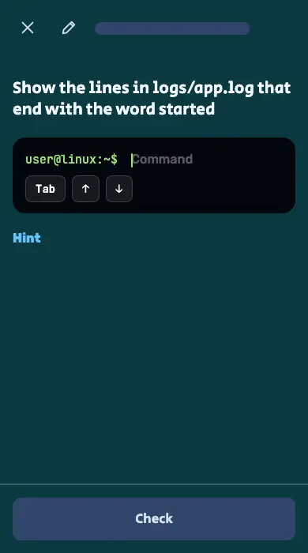
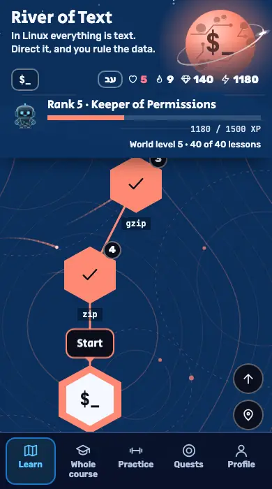
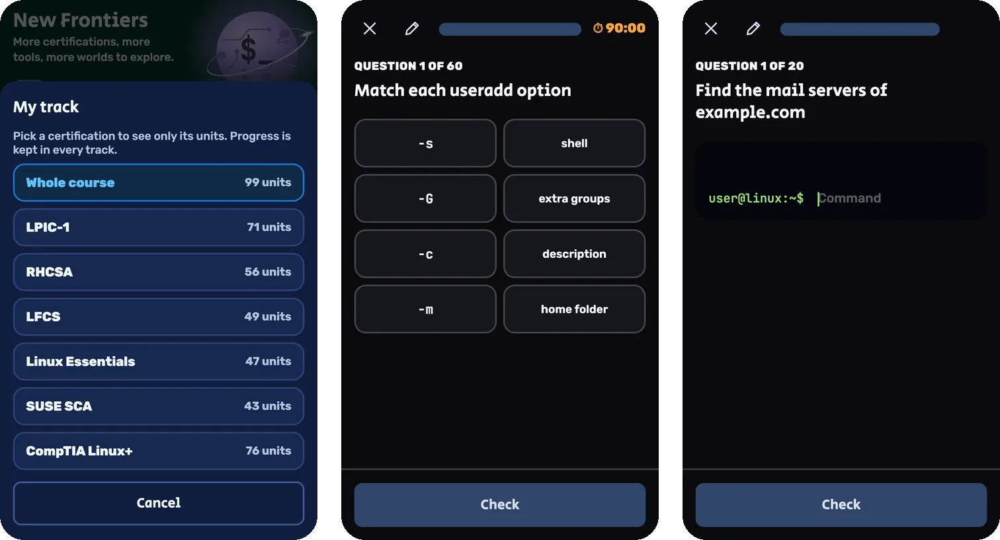
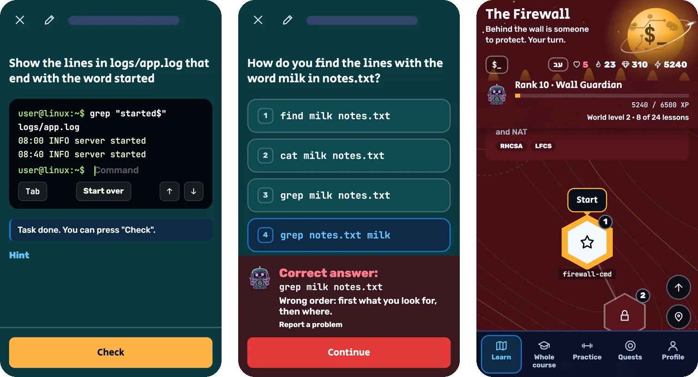
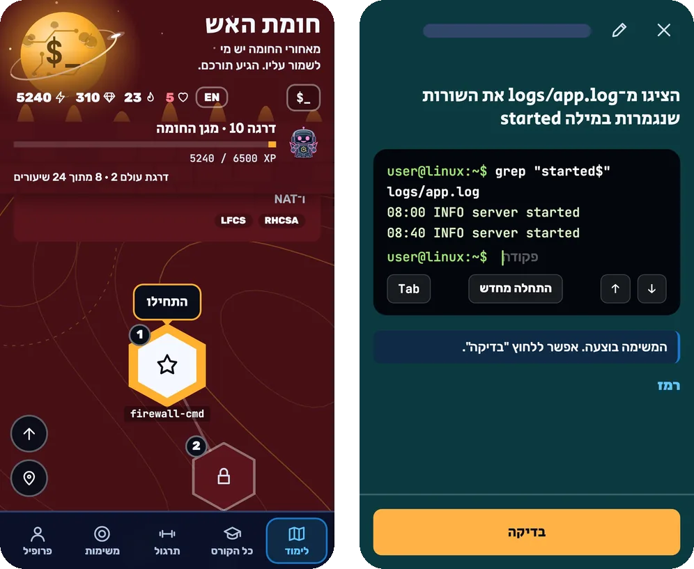
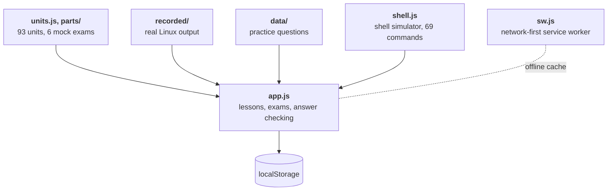

# Linux Master

[](https://github.com/SaharHalili95/linux-master/actions/workflows/tests.yml)
[](https://saharhalili95.github.io/linux-master/)

A Linux course that runs entirely in the browser, in English and Hebrew. It takes a learner from their first command to certification prep, and checks every typed answer by running it in a Linux shell simulator written from scratch in JavaScript. It is an installable, offline-capable PWA with no server, no account and no build step.

**Live:** https://saharhalili95.github.io/linux-master/

**Stack:** JavaScript (ES2022), HTML, CSS · PWA and Service Worker · Playwright · Docker · GitHub Actions CI/CD · Lighthouse CI · axe accessibility testing

<p align="center">
  
</p>

## Why I built it

Most Linux learning material assumes English, a laptop and a steady connection. I built Linux Master so that Hebrew speakers in Israel can learn Linux easily on any device, anywhere and at any time, online or offline, and so that more of them can earn official Linux certifications such as LPIC-1, RHCSA and CompTIA Linux+.

That goal set the technical requirements: a full course that works offline on a phone, practice on a real command line without a server, and answers that are checked the way Linux itself would run them.

## Engineering highlights

- **A shell simulator written from scratch** ([`shell.js`](shell.js)): a lexer and parser for a POSIX-like command line (quotes, `|`, `&&`, `||`, `;`, redirections, globs, variables, arithmetic), an in-memory file system with modes, owners and locked directories, and 69 commands including `find`, `awk`, `sed`, `sort`, `tr` and `base64`.
- **Answers are checked by behaviour, not by string matching.** A typed command is normalised first (flag order, merged flags like `-la`, quoting, spacing). If it still differs from the reference, both run in the simulator and the answer is accepted when the output matches. `sameOutput()` returns true, false or "can't tell" for unsupported commands, so the checker never guesses.
- **The simulator is tested against real Linux.** A differential test runs 570 commands in the simulator and in Ubuntu 24.04 in Docker and requires identical output.
- **No invented output.** Commands the simulator cannot run (package managers, `systemctl`, networking) show output recorded on real Ubuntu, AlmaLinux and openSUSE machines by [`tests/sandbox`](tests/sandbox).
- **Fast on a phone.** The 118 KB shell simulator loads after the first screen, and Lighthouse CI blocks any release that scores below 90 on performance.

## Features

- **93 units in 10 parts, plus 6 mock exams, about 3,000 exercises,** from your first command to every LPIC-1 v5.0 objective, plus topics from RHCSA, LFCS, Linux Essentials, SUSE SCA and CompTIA Linux+. The full unit list is in [`materials/curriculum.md`](materials/curriculum.md).
- **Six certification tracks.** Pick one and see only its units: LPIC-1 (71 units), RHCSA (56), LFCS (49), Linux Essentials (47), SUSE SCA (43) or CompTIA Linux+ (76). Progress is shared between tracks.
- **Six mock exams,** one per certification, each with the exam's question count and pass mark. LPIC-1 has 60 questions, a 90-minute timer and a 500/800 pass mark.
- **Lessons in the style of a language-learning app:** teach cards, multiple choice, fill-in, word tiles, "what will this print?" and live terminal tasks, with lives, streaks, daily quests and a boss at the end of each unit.
- **A Practice tab** that brings your mistakes back and drills from a bank of about 1,100 command questions.
- **Your data stays yours.** Progress stays in the browser, with a backup file you can save and restore.

### From the first command to advanced topics

Every part of the course is its own world, from The Gateway (`pwd`, `ls`, `cat`) through text processing, files and permissions, processes, networking, scripting and security, to New Frontiers with topics from other certifications. Each unit ends with a challenge, and a learner climbs through ranks as they earn XP. Below, a learner beats the last challenge of River of Text and moves on to City of Files.

<p align="center">
  
</p>

### Certification prep

<p align="center">
  
</p>

### Feedback that teaches

Feedback is what turns the exercises into a course:

- **A live coach in the terminal.** After every command it says what happened without giving the answer away: that the task is done, that a command that works usually prints nothing, which word looks misspelled, or what an error such as a missing file or a permission problem means.
- **An explanation for every wrong answer:** what the chosen command actually does, and why it doesn't solve this task.
- **Hints on terminal tasks,** and a review of every question at the end of a mock exam.
- **A skip test** lets a learner who already knows Linux jump ahead: it asks about every stage it would skip, terminal tasks included.

In the recording at the top of this page, the coach reacts to three wrong attempts, each in its own way: `cat` runs but doesn't do the task, `gerp` is a typo, and `grep started` also matches "started backup", so the coach points at the word to fix. Then the right command passes.

<p align="center">
  
</p>

### Fully in Hebrew

<p align="center">
  
</p>

## Architecture

Plain HTML, CSS and classic scripts that share one global scope, loaded in order. No framework and no bundler.



- **Content is bilingual at the source.** Every string is written as `T(hebrew, english)`, so both languages ship together and the interface switches without a reload.
- **Offline and updates:** the service worker serves navigations network-first and falls back to the cache, and every asset URL is versioned, so phones pick up a new release on the next open.

## Testing

Every push runs four CI jobs, and GitHub Pages deploys only after all of them pass.

| Job | What it checks |
| --- | --- |
| **browser** | About 850 Playwright tests on 4 devices (desktop Chrome, iPhone 13 WebKit, Pixel 7, iPhone SE): lesson and game flow, review scheduling, typing checks with hundreds of generated variations, both languages, offline and update flow, layout overflow, size budget, and **axe WCAG 2.1 AA** on every screen in both languages |
| **course** | Plays the whole course to the end in Chromium, all 10 parts and the mock exams, as 11 parallel jobs |
| **ubuntu-answers** | Runs every correct and wrong command answer in the practice question bank on real Ubuntu 24.04 in Docker. Then the **differential test** runs 570 commands in both the simulator and Ubuntu and requires identical output, plus a safety check that none of the 190 wrong options is accepted by output |
| **quality** | ESLint, html-validate, and Lighthouse CI with hard thresholds (performance 90, accessibility, best practices and SEO 100) |

### Bugs the tests caught

- **Wrong options that were actually right.** The Ubuntu sandbox found a ROT13 distractor that decoded correctly, and a `|` option that worked by race condition.
- **Simulator drift.** The differential test caught `file` column alignment, `wc` field widths, `ls` with several operands, `cp` into a missing directory, and a missing `/tmp`.
- **Output checking too lenient.** The safety check found 15 wrong options that produced the "right" output in a too-simple fixture (for example `cat -` waiting on the keyboard, or `grep` missing a line at the end of a file). The fixtures were made richer until it reached 0.
- **Phones.** The stats row overflowed on iPhone SE, and long answers overflowed narrow screens.
- **Mixed languages.** A scan for Hebrew characters in the English UI found sentences assembled from Hebrew fragments.

## Development

```bash
cd tests && npm ci && npx playwright install chromium webkit
npx playwright test        # browser tests (serves the site itself)
npm run sandbox            # answers on Ubuntu in Docker
npm run diff               # simulator vs Ubuntu
npm run quality            # lint + HTML validation
npx lhci autorun           # Lighthouse
node screenshots.js        # regenerate README screenshots (site on :8766)
```

## Install on a phone

Open the site in Safari or Chrome and choose **Add to Home Screen**. After the first load it works without a network.

## Author

Built by **Sahar Halili**, B.Sc. in Computer Science (HIT). [LinkedIn](https://www.linkedin.com/in/sahar-halili) · [Portfolio](https://saharhalili95.github.io/html-portfolio/) · [GitHub](https://github.com/SaharHalili95)

## Legal

© 2026 Sahar Halili. All rights reserved, except the third-party material credited on the page linked below.

Linux Master is an independent project and is not affiliated with LPI, Red Hat, the Linux Foundation, SUSE, CompTIA or OverTheWire. Certification names are marks of their owners. See the [legal, privacy and accessibility page](https://saharhalili95.github.io/linux-master/legal.html).
