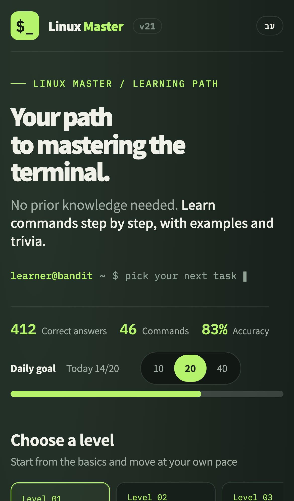
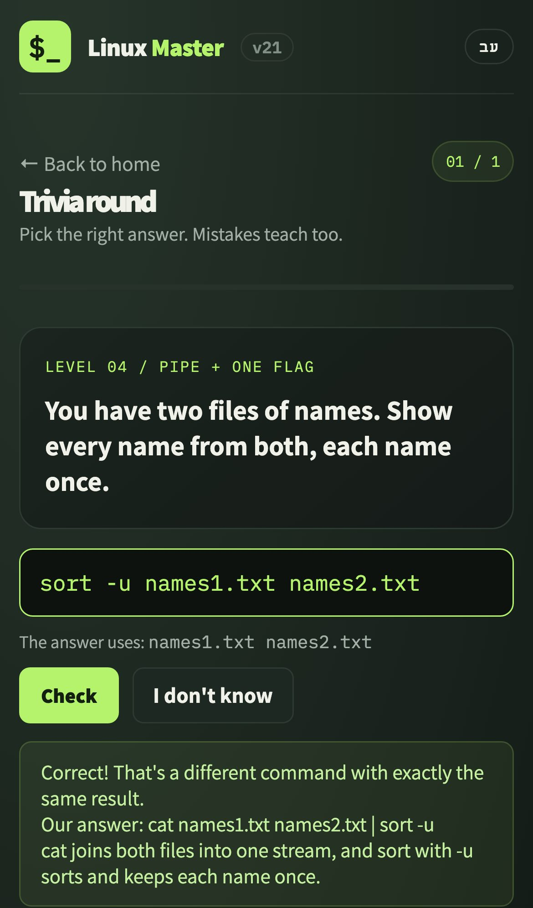
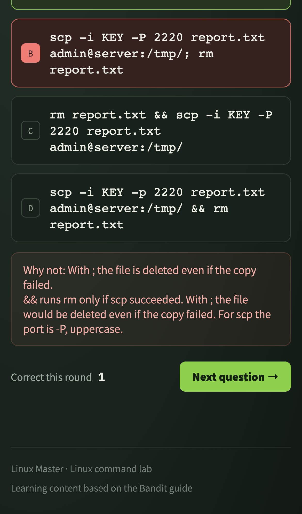
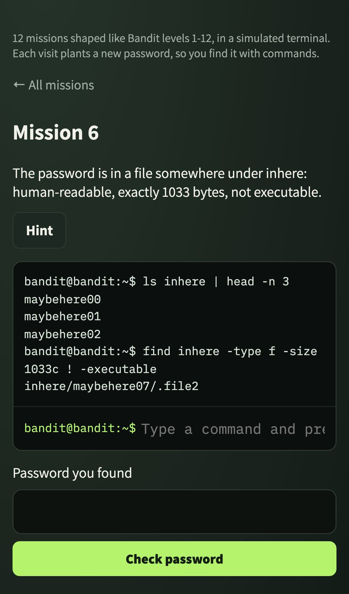
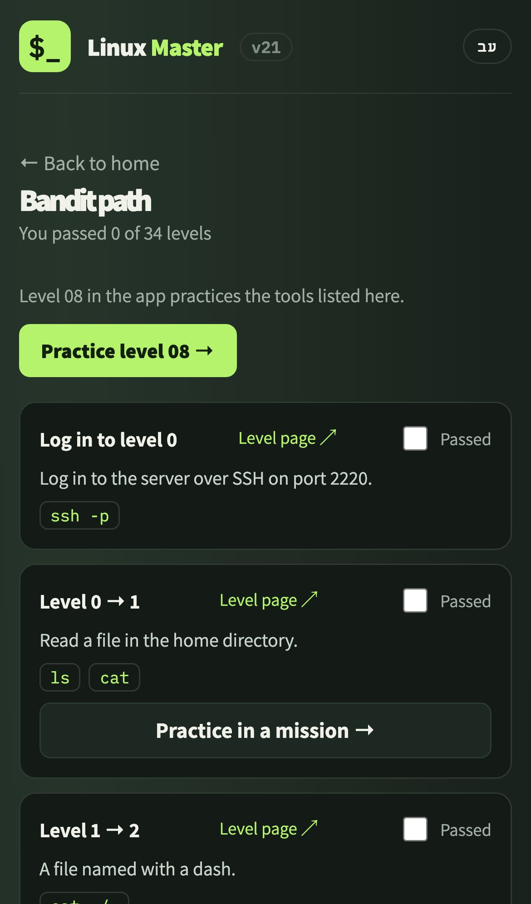
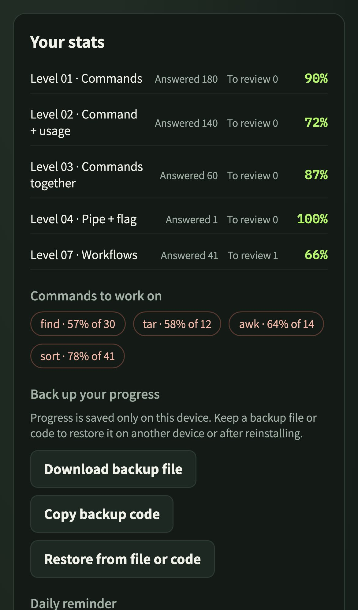
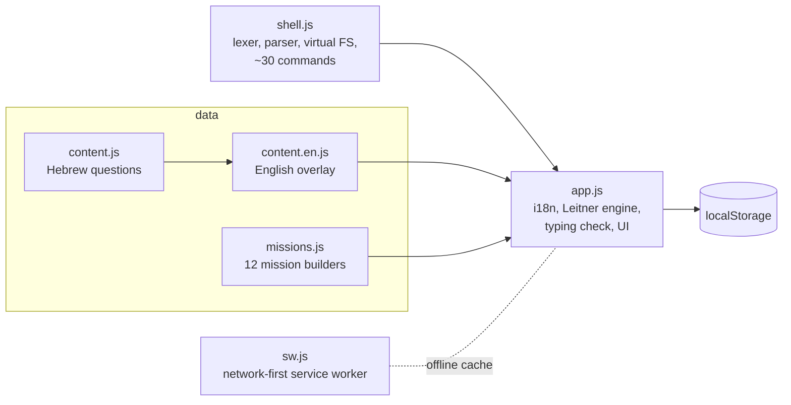

# Linux Master

[](https://github.com/SaharHalili95/linux-master/actions/workflows/tests.yml)
[](https://saharhalili95.github.io/linux-master/)

A Linux command-line trainer that runs entirely in the browser, in English and Hebrew. It drills commands with spaced repetition, checks typed answers by running them in a simulated shell, and ends with 12 terminal missions shaped like the first levels of OverTheWire Bandit. It is an installable, offline-capable PWA with no server, no account and no build step.

**Live:** https://saharhalili95.github.io/linux-master/ · [עברית](README.he.md)

<p>
  
  
  
  
</p>

## Features

- **8 levels, about 1,100 questions:** 46 commands asked in both directions, all 450 usage lines from the Bandit guide, 75 pipe and workflow scenarios, and 30 Bandit-specific tools.
- **Choice or typing, one tap to switch.** Typed answers are normalised (flag order, merged flags like `-la`, quoting, spacing). If the text still differs, the command runs in the simulated shell and is accepted when its output matches the reference answer.
- **An explanation for every wrong answer:** what the command you picked actually does, and why it doesn't solve this task.
- **Leitner review:** mistakes come back 4 questions later and at the start of later rounds until answered correctly.
- **Terminal missions:** a simulated shell with pipes, redirection, globs, `find`, `awk`, `sed`, `strings`, `base64`, `tr` and more. Every visit plants a fresh random password, so there is nothing to memorise.
- **Habits:** daily goal and streak, a calendar reminder (`.ics`), per-level and per-command accuracy.
- **Your data stays yours:** progress lives in `localStorage`, with export to file or clipboard and restore.
- **Full English and Hebrew** (RTL) interface and content, switchable at any time with shared progress.

<p>
  
  
  
  
</p>

## Architecture

Plain HTML, CSS and classic scripts that share one global scope, loaded in order. No framework and no bundler.



- **shell.js** parses a POSIX-like command line (quotes, `|`, `&&`, `||`, `;`, `>`, `2>/dev/null`, globs, variables) and runs it on an in-memory file system with modes, owners and locked directories. `sameOutput(a, b, fixture)` returns true, false, or "can't tell" for unsupported commands, so the checker never guesses.
- **Offline and updates:** the service worker serves navigations network-first and falls back to the cache, and every asset URL is versioned, so phones pick up a new release on the next open.

## Testing

Every push runs three CI jobs, and GitHub Pages deploys only after all of them pass.

| Job | What it checks |
| --- | --- |
| **browser** | About 380 Playwright tests on 4 devices (desktop Chrome, iPhone 13 WebKit, Pixel 7, iPhone SE): game flow, review scheduling, typing checks with hundreds of generated variations, both languages, offline and update flow, layout overflow, size budget, and **axe WCAG 2.1 AA** on every screen in both languages |
| **ubuntu-answers** | Runs every correct and wrong answer of levels 3-8 on real Ubuntu 24.04 in Docker. Then a **differential test** runs 570 commands both in the simulator and in Ubuntu and requires identical output, plus a safety check that none of the 190 wrong options is accepted by output |
| **quality** | ESLint, html-validate, and Lighthouse CI with hard thresholds (performance 90, accessibility, best practices and SEO 100; currently 98/100/100/100) |

A weekly job also checks that every link to the official Bandit pages is still alive.

### Bugs the tests caught

- **Wrong options that were actually right.** The Ubuntu sandbox found a ROT13 distractor that decoded correctly, and a `|` option that worked by race condition.
- **Simulator drift.** The differential test caught `file` column alignment, `wc` field widths, `ls` with several operands, `cp` into a missing directory, and a missing `/tmp`.
- **Output checking too lenient.** The safety check found 15 wrong options that produced the "right" output in a too-simple fixture (for example `cat -` waiting on the keyboard, or `grep` missing a line at the end of a file). The fixtures were made richer until it reached 0.
- **Phones.** The stats row overflowed on iPhone SE, and long answers overflowed narrow screens.
- **Mixed languages.** A scan for Hebrew characters in the English UI found sentences assembled from Hebrew fragments.

## Run locally

```bash
cd tests && npm ci && npx playwright install chromium webkit
npx playwright test        # browser tests (serves the site itself)
npm run sandbox            # answers on Ubuntu in Docker
npm run diff               # simulator vs Ubuntu
npm run quality            # lint + HTML validation
npx lhci autorun           # Lighthouse
node screenshots.js        # regenerate README screenshots (site on :8766)
```

To add a language, add a dictionary to `I18N` in `app.js`, a content overlay to `CONTENT`, and the code to `LANGS`.

## Install on a phone

Open the site in Safari or Chrome and choose **Add to Home Screen**. After the first load it works without a network.
