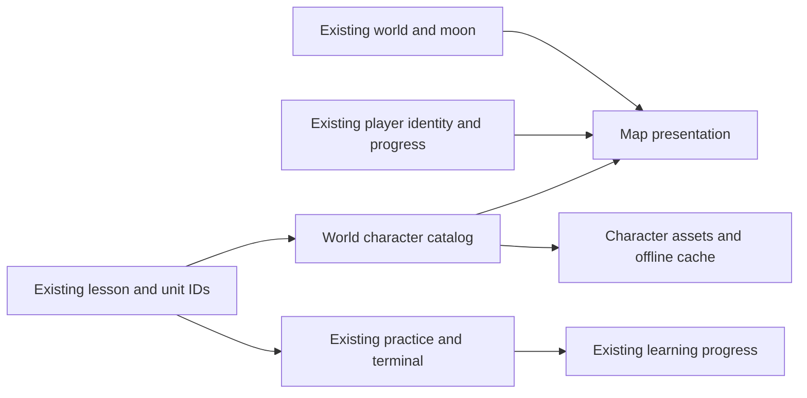

# Linux Master: game foundation

## Product intent and invariants

Linux Master is a playable Linux learning experience for newcomers, experienced technology professionals and younger players. The visual direction combines a cinematic cyber adventure, expressive technological creatures and robots within one coherent world. Appeal, comprehension and learning outcomes must be tested with actual users; none is assumed from visual polish alone.

The original moon represents Sahar, is independent of the learner and changes with each world. Preserve `moonSvg`, scenery, animated stars, bolts, orbital and energy effects in `prototype/world.js`. Do not replace them when changing characters. Preserve existing questions, answers, simulations, translations, save keys, progress, rankings and certification tracks. No art role is a certification or a measure of knowledge.

## Boundaries

| Concern | Current source | Responsibility |
| --- | --- | --- |
| Learner identity | `prototype/character.js`, `prototype/avatar-options.js`, existing XP and rank | Three player forms, four palette choices, expression and existing rank equipment. Independent from the NPC. |
| World and mission progression | `prototype/game-progress.js` | Derives five world levels, unit completion and mock-exam medals from unique saved completion keys. |
| World expeditions | `prototype/world-expeditions.js`, `prototype/expedition-play.js`, `prototype/expedition-ui.js` | Completed-lesson challenge pools, first-attempt records, unlocks, equipment and isolated result presentation. |
| Contextual introductions | `prototype/story-missions.js` | Bilingual introductions to existing learning tasks; no alternate answers or scoring. |
| Worlds and Sahar's moon | `prototype/world.js` | Current eleven regions, moon, backgrounds and motion. |
| Learning and progress | `prototype/lessons.js`, `prototype/units.js`, `prototype/parts/`, `prototype/app.js` | Lessons, objectives, exercises, scoring, certification tracks and saved progress. |
| World character roles | `prototype/character-art.js` | Catalog of available visual roles, stable world defaults and unit-specific assignments. |
| Rendering and layout | `prototype/app.js`, `prototype/styles.css` | Placement in the path. Decorative world characters do not act as controls or replace the learner. |
| Offline delivery | `prototype/app.js`, `sw.js` | Cache catalog assets after the full course is ready; keep network-first Learn behavior. |

The earlier `world-characters.js` and its vector assets remain in the repository. Its global is currently superseded by `character-art.js`; consolidate the renderers only in a separately verified change that preserves those assets. The player's existing `mascot` replacement and feedback observer remain in use; appearance selection is a separate, replaceable module.

## Character catalog contract

`worldCharacterCatalog.characters` contains role IDs and their art paths. `roleFor(unit)` resolves a unit-specific override first, then its world default and finally a safe explorer fallback for unknown input. Resolution uses stable unit and section numbers, not translated title strings. `assetPaths()` supplies the offline preload list from the same catalog. `worldCharacter(unit)` renders decorative art; CSS controls size. A new role requires an asset, a catalog entry, any relevant world or unit assignment, deployment inclusion, a suitable alternative representation if the role becomes meaningful content, and tests. A new or remapped unit must be reviewed for an appropriate assignment; world fallback is safe but is not editorial approval.

Keep asset filenames unique and version changed assets so a returning user's cache can update. No user data or course content should be added to this catalog. The present six illustrated roles are a starting library, not an individual design for each unit or a complete character universe.

## Implemented gameplay foundation

1. The player enters a world under Sahar's original moon. The player character stays separate from the world characters. Profile controls select Core, Scout or Guardian and the automatic rank palette, Mint, Cyan or Violet. The forms vary head and body silhouettes; they are variations within the existing robot family, not three newly illustrated character assets.
2. The current lesson's popover offers a bilingual contextual introduction and unit completion count. Finishing the last distinct lesson announces unit completion once. Replaying a lesson, collecting a chest or defeating a boss does not duplicate that completion. This is a narrative layer around existing lessons, not a branching story campaign.
3. World levels are derived from unique completed lessons against the full loaded course. Levels 1–5 correspond to starting, quarter, half, three-quarter and full completion. Exam-only worlds count mock exams instead. Loading or unavailable data never awards a level or medal. Existing earned XP and rank equipment are unchanged; world level 2 now unlocks one topic-specific cosmetic per learning world and the five-exercise expedition mode when enough eligible exercises exist.
4. Profile medals distinguish six mock-exam passes from attempts not yet passed. Existing tagged question pools create varied practice attempts. These are not newly authored fixed exam papers, and no official certification or external verification is claimed.
5. Quests offers three-exercise Explore runs and five-exercise Streak runs drawn without duplicate canonical IDs from completed lessons in learning worlds 1–10. Wrong matches and retries cannot improve first-attempt results. Completion saves a bounded personal best; quitting saves no result. Runs do not award XP, gems, lesson completion or official medals, and do not consume lives.
6. Profile offers ten world equipment items, earned at world level 2, alongside existing rank equipment. One world item can be selected or explicitly unequipped. Saved locked selections survive loading but never render as earned. Actual character previews preserve Core, Scout and Guardian identities when palettes change.
7. Appearance and equipment fields and expedition bests survive reload and the existing file backup/restore flow. The merge helper resolves each valid selection by its timestamp, with a stable tie-break. Invalid selections cannot override valid ones using a corrupt timestamp. The app still saves on this device; no account or cloud synchronization UI is introduced.
8. Optional gameplay modules can fail to load without blocking existing lessons or resetting earned progress. The new assets are included in deployment and the existing offline caching path. Progress calculations, appearance choices, story text and rendering remain separate so later visual changes do not require changing the course.

## Remaining product validation

An experienced learner should reach practice without forced repetition; a beginner needs a legible objective and optional help. Children and experienced developers are overlapping audiences, not established personas. Compare the learning loop with representative users before expanding narrative or art production. A practice pass, a course completion and an externally verified certification must remain distinct.

## Visual system and scaling principles

- Characters need distinctive silhouettes, expressions and roles visible at actual phone size. Test each art asset on every target background; avoid relying on color alone.
- Keep semantic identities and asset paths separate from visual rendering so art can be replaced or restyled without editing lesson copy, exam logic or learner progress.
- Keep illustrations decorative unless they carry unique information; if they do, provide localized accessible text and an appropriate semantic control where needed.
- Support Hebrew RTL and English LTR. Verify 320px, 390px and desktop layouts, zoom, focus and target sizes.
- Preserve existing motion as the default. Respect reduced-motion preferences and provide appropriate pause controls where required. Test actual lightning flashes and contrast; do not claim accessibility conformance without measurements.
- Add characters progressively; avoid loading high-resolution assets at startup, preserve offline readiness, and measure mobile performance.

## Validation gates

1. Unit and world IDs resolve to catalog roles, regardless of title wording or language. Every catalog asset exists, is deployed and is available when Learn is marked offline-ready.
2. Player appearance and world characters are independently testable. A character theme or asset change cannot alter saved progress, questions, answers or certification logic.
3. Compare original moon, background, lightning and stars before and after on multiple worlds, at mobile and desktop sizes. Check the original renderers have not changed unless explicitly authorized.
4. Test page and lesson flow, existing saved progress, localization, keyboard, motion preference, lazy image loading, missing assets and offline/reconnection paths. Run lint, HTML validation and relevant browser tests.
5. Evaluate a vertical slice with representative players before expanding art production: identify player versus NPC, understand the task, complete a terminal action and return later. Track completion, errors and delayed retention separately from appeal and cosmetic engagement. Small qualitative samples reveal usability issues but do not prove a commercial winner.

## Known limitations and decisions

The map still presents a contextual character once per unlocked unit. The catalog chooses presentation and has no persistence. Story introductions and completion feedback do not constitute authored NPC conversations or a branching quest engine. World levels unlock ten cosmetics and the Streak mode; rank equipment continues to follow existing XP ranks. Expeditions reuse existing exercises, rather than adding new authored exam papers or a combat system. Proof of external certifications is outside this implementation. Existing CSS and player rendering retain historical overrides; broad rewrites require a separate migration plan and regression coverage. Automated tests and visual inspection do not establish physical-device coverage, long-term learning retention, commercial success or a 10/10 outcome.

## Screen and system blueprint

The current structure keeps presentation and learning state independent:

```text
WORLD MAP                         LEARNING MOMENT
Sahar's world-specific moon       Existing lesson heading and progress
Existing animated scenery         Contextual introduction and unit progress
Player identity and progress      Existing prompt and terminal
World entrance and context        Check, hint and respectful feedback
Path and current objective        Result and return to the same map
```

On small screens, the moon and scenery remain recognizable while lesson content and controls stay readable and unobstructed. The learner can identify their own character separately from the world guide. The map, exercise and lesson introductions are implemented. Authored NPC interactions would need separate design and validation.



The diagram describes existing integration points, not a new game engine. The future art direction can be swapped within the catalog; a renderer for animated or interactive NPCs would need an explicit contract, accessibility review, lifecycle rules and new tests before adoption.

## Vertical slice acceptance

Use the first navigation unit as a controlled slice because its existing lesson includes `pwd`, `ls` and `cd`. Preserve the current exercise copy and correct answers. Compare 2–3 visual treatments using the same content and original moon. At a minimum, a participant should be able to identify their player, describe the world character's role, start the current exercise, complete a terminal action, understand feedback and return to the map. Record qualitative observations and task completion separately; do not infer retention or sales from a small design review. Test reduced motion, keyboard, Hebrew and English, mobile and desktop before considering expansion.
