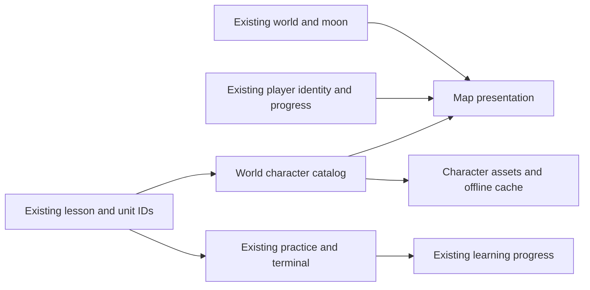

# Linux Master: game foundation

## Product intent and invariants

Linux Master is a playable Linux learning experience for newcomers, experienced technology professionals and younger players. The visual direction combines a cinematic cyber adventure, expressive technological creatures and robots within one coherent world. Appeal, comprehension and learning outcomes must be tested with actual users; none is assumed from visual polish alone.

The original moon represents Sahar, is independent of the learner and changes with each world. Preserve `moonSvg`, scenery, animated stars, bolts, orbital and energy effects in `prototype/world.js`. Do not replace them when changing characters. Preserve existing questions, answers, simulations, translations, save keys, progress, rankings and certification tracks. No art role is a certification or a measure of knowledge.

## Boundaries

| Concern | Current source | Responsibility |
| --- | --- | --- |
| Learner identity | `prototype/character.js`, existing XP and rank | Player appearance, expression and existing upgrades. Not the NPC. |
| Worlds and Sahar's moon | `prototype/world.js` | Current eleven regions, moon, backgrounds and motion. |
| Learning and progress | `prototype/lessons.js`, `prototype/units.js`, `prototype/parts/`, `prototype/app.js` | Lessons, objectives, exercises, scoring, certification tracks and saved progress. |
| World character roles | `prototype/character-art.js` | Catalog of available visual roles, stable world defaults and unit-specific assignments. |
| Rendering and layout | `prototype/app.js`, `prototype/styles.css` | Placement in the path. Decorative world characters do not act as controls or replace the learner. |
| Offline delivery | `prototype/app.js`, `sw.js` | Cache catalog assets after the full course is ready; keep network-first Learn behavior. |

The earlier `world-characters.js` and its vector assets remain in the repository. Its global is currently superseded by `character-art.js`; consolidate the renderers only in a separately verified change that preserves those assets. Likewise the player's existing `mascot` replacement and feedback observer are current behavior, not a finalized player-customization architecture.

## Character catalog contract

`worldCharacterCatalog.characters` contains role IDs and their art paths. `roleFor(unit)` resolves a unit-specific override first, then its world default and finally a safe explorer fallback for unknown input. Resolution uses stable unit and section numbers, not translated title strings. `assetPaths()` supplies the offline preload list from the same catalog. `worldCharacter(unit)` renders decorative art; CSS controls size. A new role requires an asset, a catalog entry, any relevant world or unit assignment, deployment inclusion, a suitable alternative representation if the role becomes meaningful content, and tests. A new or remapped unit must be reviewed for an appropriate assignment; world fallback is safe but is not editorial approval.

Keep asset filenames unique and version changed assets so a returning user's cache can update. No user data or course content should be added to this catalog. The present six illustrated roles are a starting library, not an individual design for each unit or a complete character universe.

## Experience design proposal, not implemented

1. The player enters a world under Sahar's original moon. The player character remains visually distinct from characters met in the world.
2. A world character introduces a relevant objective at a meaningful moment, not automatically at every node. The user practices an actual Linux task with existing exercises and terminal behavior.
3. A clear result, constructive feedback and the next appropriate challenge follow. Failure should not be represented by an angry or shaming character.
4. World-specific visual progression, cosmetics and medals can be designed after the prototype is tested. A practice completion, mock exam completion and externally verified certification must be labeled distinctly. Never imply a mock exam is an official certification.
5. An experienced learner should reach practice without forced repetition; a beginner needs a legible objective and optional help. Children and experienced developers are overlapping audiences, not assumed personas.

These are concepts to prototype and validate, not claims that new gameplay, customization, badges or certification verification already exist. Do not add mechanics or change content without a specific approved scope.

## Visual system and scaling principles

- Characters need distinctive silhouettes, expressions and roles visible at actual phone size. Test each art asset on every target background; avoid relying on color alone.
- Keep semantic identities and asset paths separate from visual rendering so art can be replaced or restyled without editing lesson copy, exam logic or learner progress.
- Keep illustrations decorative unless they carry unique information; if they do, provide localized accessible text and an appropriate semantic control where needed.
- Support Hebrew RTL and English LTR. Verify 320px, 390px and desktop layouts, zoom, focus and target sizes.
- Preserve existing motion as the default. Respect reduced-motion preferences and provide appropriate pause controls where required. Test actual lightning flashes and contrast; do not claim accessibility conformance without measurements.
- Add characters progressively; avoid loading high-resolution assets at startup, preserve offline readiness, and measure mobile performance.

## Validation gates for future changes

1. Unit and world IDs resolve to catalog roles, regardless of title wording or language. Every catalog asset exists, is deployed and is available when Learn is marked offline-ready.
2. Player appearance and world characters are independently testable. A character theme or asset change cannot alter saved progress, questions, answers or certification logic.
3. Compare original moon, background, lightning and stars before and after on multiple worlds, at mobile and desktop sizes. Check the original renderers have not changed unless explicitly authorized.
4. Test page and lesson flow, existing saved progress, localization, keyboard, motion preference, lazy image loading, missing assets and offline/reconnection paths. Run lint, HTML validation and relevant browser tests.
5. Evaluate a vertical slice with representative players before expanding art production: identify player versus NPC, understand the task, complete a terminal action and return later. Track completion, errors and delayed retention separately from appeal and cosmetic engagement. Small qualitative samples reveal usability issues but do not prove a commercial winner.

## Known limitations and decisions

The existing stage layout shows a character once per unlocked unit and currently has no authored narrative interactions, gameplay events or per-world customization. The catalog only selects presentation and has no persistence. Choosing when NPCs appear, designing actual mission interactions, player customization, world-specific rewards and proof of external certifications are future product decisions. Existing CSS and player rendering still have historical overrides; avoid broad rewrites without a separate migration plan and regression coverage. The implementation does not claim full accessibility, complete performance coverage, or a 10/10 outcome.

## Screen and system blueprint

The following is an intended structure for a later visual prototype, not a representation of currently implemented interactions:

```text
WORLD MAP                         LEARNING MOMENT
Sahar's world-specific moon       Existing lesson heading and progress
Existing animated scenery         World character: optional objective
Player identity and progress      Existing prompt and terminal
World entrance and context        Check, hint and respectful feedback
Path and current objective        Result and return to the same map
```

On small screens, the moon and scenery remain recognizable while lesson content and controls stay readable and unobstructed. The learner can identify their own character separately from the world guide. The map and exercise already exist; character introductions and contextual interactions in this sketch require further design and authorization.



The diagram describes existing integration points, not a new game engine. The future art direction can be swapped within the catalog; a renderer for animated or interactive NPCs would need an explicit contract, accessibility review, lifecycle rules and new tests before adoption.

## Vertical slice acceptance

Use the first navigation unit as a controlled slice because its existing lesson includes `pwd`, `ls` and `cd`. Preserve the current exercise copy and correct answers. Compare 2–3 visual treatments using the same content and original moon. At a minimum, a participant should be able to identify their player, describe the world character's role, start the current exercise, complete a terminal action, understand feedback and return to the map. Record qualitative observations and task completion separately; do not infer retention or sales from a small design review. Test reduced motion, keyboard, Hebrew and English, mobile and desktop before considering expansion.
